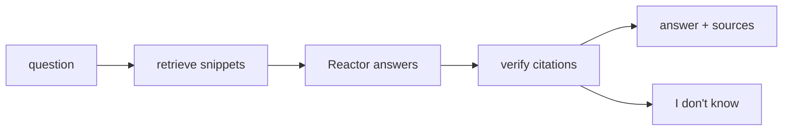

# Recall

Long-term memory for AI assistants: every answer shows where it came from, or says "I don't know".

Our retrieval finds the few relevant snippets in months of chat history. Reactor writes every final answer from
them and cites its sources; we verify the citations. When the history doesn't contain the answer, Recall says
"I don't know".

Our submission to the RxAI Memory Retrieval Challenge ([brief](CHALLENGE.md), [data format](format.md)).

## Results

| | Value |
|---|---|
| Test questions handled by Reactor | 146 / 146 |
| Answers with a cited source | 123 |
| "I don't know" | 23 (16%, down from 21% in our first run) |
| Text read per question vs the full history | ~147× less |
| vs loading a user's history once | ~15× less |
| Trick questions answered "I don't know" (hard dev-large sample) | 6 / 6 |

Details and dev metrics: [docs/DETAILS.md](docs/DETAILS.md).

## How it works



- **Index:** every turn of the history, both user and assistant, is searchable (BM25, standard library only).
- **Retrieve:** the best 5 sessions (8 for counting, time and name questions), trimmed to the relevant turns.
- **Dates:** each snippet carries its date and "N days before the question"; the latest is marked most recent.
- **Answer:** Reactor answers from the labelled snippets `[E1]..[En]` through the organisers' client.
- **Verify:** Reactor's labels become session citations; "insufficient evidence" becomes "I don't know".

## Quickstart

1. Create a virtual environment (Python 3.11+) and install the two dependencies:

   ```sh
   python3 -m venv .venv && . .venv/bin/activate && pip install websockets streamlit
   ```

2. Download `dev.tar.gz` and `test.tar.gz` from the challenge's
   [Releases](https://github.com/RxAI-dev/memory-challenge/releases) into the repository root and extract them:

   ```sh
   tar -xzf dev.tar.gz && tar -xzf test.tar.gz
   ```

3. Set the access key at a hidden prompt. Never put it in a file or on a command line.

   ```sh
   printf 'Access key: '; read -rs REACTOR_ACCESS_KEY; echo; export REACTOR_ACCESS_KEY
   ```

4. Run the test set (about 3 hours on one agent; rerun the same command to resume):

   ```sh
   python run_v3_test.py --questions test/questions.jsonl --histories test/histories.jsonl \
       --base-url <your base URL> --agent-id <your agent id> --out results-test-v3.jsonl
   ```

5. Build the predictions:

   ```sh
   python make_predictions.py results-test-v3.jsonl --questions test/questions.jsonl --out predictions.jsonl
   ```

The submission is tagged `final-submission`.

## Other commands

```sh
python eval_retrieval.py dev --version 3                 # evaluate retrieval offline
python score.py dev/gold.jsonl predictions.jsonl          # score a dev run (steps 4-5 with dev/)
streamlit run app.py --server.address localhost           # the demo app (never calls Reactor by default)
```

## Files

| File | Role |
|---|---|
| `retrieval.py` | search index, routing and snippets |
| `run_v3_test.py` | the driver that produced the submission (built on `run.py`) |
| `make_predictions.py` | results → `predictions.jsonl`: citations and "I don't know" |
| `predictions.jsonl`, `results-test-v3.jsonl` | the submission and Reactor's raw results |
| `eval_retrieval.py`, `score.py` | offline retrieval metrics; scoring against dev gold |
| `app.py` | the demo app |
| `tests/` | unit tests, with a fake client that never calls Reactor |
| `reactor/` | the organisers' kit, unchanged |

## Rules we followed

- Every final answer comes from Reactor, through the organisers' unmodified client.
- No external LLM or embedding API anywhere in the pipeline.
- One Reactor history per dataset history; one was split after a timeout (see
  [DETAILS](docs/DETAILS.md#5-the-test-runs)).
- Citations follow the organisers' ruling: Reactor's own labels, or only snippets that contain its answer.

## Team

Amaan Rais Shah, Dedar Alam, Frensi. Built with Claude Code as a coding assistant.
