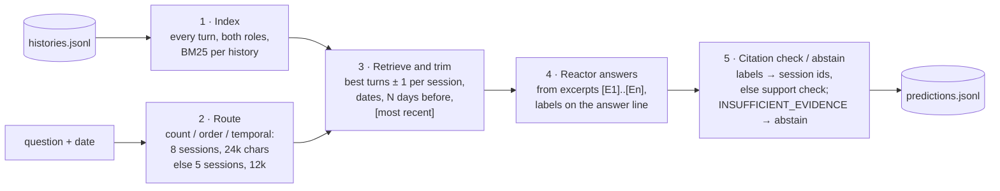

# Recall: grounded long-term memory on Reactor

Our submission to the RxAI Memory Retrieval Challenge. The organisers' brief is in [CHALLENGE.md](CHALLENGE.md);
the data format is in [format.md](format.md).

## 1. Summary

For each question, our own code finds the few turns that matter in a history of hundreds of conversations
(turn-level BM25, standard library only), sends them to Reactor as dated, labelled excerpts, and turns Reactor's
reply into a prediction. **Every final answer comes from Reactor.** Citations are Reactor's own `[E#]` labels; when
it gives none, we cite only excerpts that actually contain its answer. When Reactor says the evidence doesn't answer
the question, we abstain, with no citations.

Headline results:

| | |
|---|---|
| Retrieval, dev (526 questions, ~50 sessions per history) | a gold session in the top 5 for **98.2%** of answerable questions |
| Retrieval, dev-large (130 questions, ~500 sessions per history) | **93.5%** |
| Characters sent per test question | median **11.3k** (whole message, v3) vs **~1.66M** for the full history |
| Test run (v3, the submission) | **146 of 146** questions handled: **123 answers** citing their sources, **23 abstained (16%)** |

## 2. Architecture



| File | Role |
|---|---|
| `retrieval.py` | the index, routing, evidence building (`HistoryIndex`) |
| `run.py` | the benchmark driver: one Reactor history per dataset history, via `reactor/client.py` |
| `make_predictions.py` | results → `predictions.jsonl`: citation rules, abstention, late-reply recovery |
| `listen.py` | after a timeout, listens on the Reactor history (sending nothing) for the late answer |
| `tests/` | `python -m unittest discover tests` |
| `eval_retrieval.py` | offline retrieval metrics on dev splits (no Reactor calls) |
| `run_v3_test.py` | **the driver for the submitted predictions**: `run.py`'s driver with v3 evidence and question text |
| `run_v2.py`, `run_v3.py` | the first v2 and v3 drivers (section 7); `run_v3_test.py` sends the same questions |
| `compare.py` | two runs side by side against gold (dev) |
| `efficiency.py` | characters sent per question and per history, against the full history (section 10) |
| `app.py` | the Recall demo (section 11) |

## 3. Setup

```sh
python3 --version                          # 3.11 or newer (reactor/client.py needs it)
python3 -m venv .venv && . .venv/bin/activate
pip install websockets streamlit           # websockets for the Reactor client; streamlit only for the demo
```

Data: download `dev.tar.gz` and `test.tar.gz` (and dev-large, optional) from the challenge's
[Releases](https://github.com/RxAI-dev/memory-challenge/releases) page and extract them in the repo root, giving
`dev/`, `test/` (and `dev-large/`). `convert_longmemeval.py` rebuilds the dev splits from LongMemEval if needed.

Access key: type it at a hidden prompt, in the terminal you run from. **Never put it on a command line, in a file
or in a chat.**

```sh
printf 'Access key: '; read -rs REACTOR_ACCESS_KEY; echo; export REACTOR_ACCESS_KEY
```

## 4. Reproducing predictions.jsonl

The submitted `predictions.jsonl` is v3 (section 7), with `run_v3_test.py`'s defaults: no missing-words hint and
the lenient abstain line.

```sh
python run_v3_test.py --questions test/questions.jsonl --histories test/histories.jsonl \
    --base-url https://tNN.api.reactor-hackathon.rxai.dev --agent-id agt_... --out results-test-v3.jsonl
python make_predictions.py results-test-v3.jsonl --questions test/questions.jsonl --out predictions.jsonl
```

`run_v3_test.py` appends each answer to `results-test-v3.jsonl` as it arrives (committed) and logs the evidence it
sent to `results-test-v3.evidence.jsonl`; `make_predictions.py` validates its output with `score.py`'s format
check. On dev, `python score.py dev/gold.jsonl predictions.jsonl` scores it.

The v3 run used the code at commit `5ada236`; `retrieval.py`, `run.py`, `run_v3_test.py` and `make_predictions.py`
are unchanged since (tag `final-submission` adds only the app, the README and `efficiency.py`).
`tests/test_run_v3_test.py` proves, with a recording stand-in for the client, that `run_v3_test.py` sends exactly
what `run_v3.py --no-hint --lenient` sends (question text, date, `--max-chars` and evidence bytes): on the first 40
dev questions as a unit test, and on all 526 (and `sample_hard`) with `python tests/test_run_v3_test.py <questions>
<histories>`.

**The v1 run**, kept for comparison: `results-test.jsonl` and `predictions-v1.jsonl`, from `run.py` and
`make_predictions.py results-test.jsonl ...`.

| Result lines | Driver | Notes |
|---|---|---|
| 1–32 | tag `v1-test-run` | client timeout 300 s (the kit's default) |
| 33 onwards | tag `v1.1-test-run` | after a mid-run restart: driver changes only (section 5) |

`predictions-v1.jsonl` is built with `make_predictions.py` at `v1.1-test-run`. Between the two tags, **v1's evidence
and question text are byte-identical**: we ran both drivers on all 526 dev questions with a recording stand-in for
the client and compared the question text, date, `--max-chars` and evidence bytes of every question (0
differences), and the evidence logs (identical, 9,050,462 bytes). Only the driver's behaviour changed.

## 5. Driver behaviour

Following the organisers' guidance on Discord:

- **One Reactor history per dataset history**, started with `--new-history`, never reset mid-history.
- **`--timeout 600`** for every question.
- **A timeout doesn't cancel the question on Reactor's side**, so the driver first sends nothing and listens on the
  same Reactor history for up to 120 s for its late answer (`listen.py`, with the client's backoff). Only if none
  arrives is the question asked once more in the same history; the client keeps retrying while the previous
  request hasn't cleared (`previous_pending`). (The first part of the test run, up to `v1.1-test-run`, retried
  after 30 s without listening.)
- **Late answers are recovered.** If Reactor's final answer to a timed-out question arrives later, in another
  question's `late_replies` (matched by its ref), it is recorded as that question's answer, marked `recovered`.
  `make_predictions.py` keeps exactly one line per question: the original question's late answer over a retry's,
  otherwise the earlier of two answered lines (`tests/test_make_predictions.py`).
- **Wait for the agent after a new history** (`run.py` and `run_v3_test.py` since `5ada236`). A new history
  restarts the agent, and a question sent before it is back up fails at once (chat closed, HTTP 403 or
  `history_resetting`). So the driver waits 15 s (`--settle`) after `--new-history`, and a question that fails
  that way before anything is answered in its Reactor history is asked again in the same history after 10, 20
  and 40 s. Every attempt is still recorded. In the v3 test run no question needed it.
- **Resume without a reset.** After a restart, the dataset history in progress continues in its Reactor history
  (the agent's current one), before any other history is started.

Transparency: 2 questions (`q_1a6b4fa2ede3`, `q_aa27ddd3b7c5`) timed out under `v1-test-run`, and no late
answer for them ever arrived. Their Reactor history had already been replaced when we restarted, so they are
asked again in a fresh Reactor history for their dataset history, the kit's documented rerun behaviour
(`reactor/QUICKSTART.md`, "A rerun starts a new Reactor history"). Every question carries its own evidence, so
nothing from the earlier history is needed.

In the v3 run, one dataset history (`h_8224cd1fdcd0`, 10 questions) was split across two Reactor histories. Its
fifth question, `q_3664132a79f0`, timed out after 600 s; no late answer arrived while the driver listened, and when
it was asked again in the same Reactor history the server refused with `history_changed`, so the driver started a
new Reactor history for that dataset history and asked it and the remaining five questions there. All 10 were
answered (the first four in the first Reactor history). The other 14 dataset histories each used one Reactor
history, and the run had no other timeout, error or refusal: 147 result lines for 146 questions.

## 6. Design decisions

- **Turn-level BM25 with session aggregation.** Each turn is a chunk (long turns split into 1,500-character
  windows); a session scores its best chunk plus 0.25 × its next two. Turns, not sessions, because a session is
  ~10k characters and the fact is usually in one turn.
- **Assistant turns are indexed.** "What did you recommend…" questions are answered only by assistant turns.
- **Question routing.** Counting, totalling, comparing and ordering questions ("how many", "which first", "how
  long ago") get 8 sessions in 24,000 characters (`--max-chars 30000`); others 5 sessions in 12,000.
- **Dates done in code.** Each excerpt carries its session date and "(N days before the question date)"; the
  latest excerpt is marked `[most recent]`, so knowledge-update questions take the latest value.
- **Answer instructions.** Every question: put the `[E#]` labels on the FINAL ANSWER line, one value, no
  hedging. Questions about a value that may have changed: "the most recent date wins", except when the question
  asks for the previous or original value.
- **Citation rules** (per the organisers' ruling that fallback citations must support Reactor's answer):
  1. Reactor's labels on the answer line;
  2. else the labels in the last paragraph of its reasoning;
  3. else a support check: the excerpts that contain Reactor's answer (normalized as `score.py` does), or ≥ 60%
     of its content words, and only if that picks out at most half of the excerpts (a bare "2" matches all of
     them, so it cites nothing);
  4. abstentions cite nothing. We never fall back to the top-ranked session.

## 7. v2 and v3 (the submitted version)

v2 (`retrieval.py` `version=2`, `run_v2.py`) adds to v1:

- **Focused trimming**: a long turn keeps the stretch with the most question words, not its beginning.
- **Lead-session budget**: a clearly leading session gets up to half the budget.
- **Time sentences**: for temporal and counting questions, the user's sentences that say when something happened
  ("last month", "three weeks ago"), from anywhere in a sent session.
- **Missing-words hint** for near-miss traps: "the evidence never mentions: X. If the answer depends on these,
  answer INSUFFICIENT_EVIDENCE".
- **Work-it-out prompt** for aggregate questions: compute a difference, total, count or order before the
  answer line.

| | hit@5 v1 | hit@5 v2 | sent v1 | sent v2 | ans∈ev v1 | ans∈ev v2 |
|---|---|---|---|---|---|---|
| dev (496 answerable) | 0.982 | 0.982 | 0.954 | 0.954 | 0.542 | **0.556** |
| dev-large (124 answerable of 130) | 0.935 | 0.935 | 0.878 | 0.878 | 0.484 | **0.492** |

*hit@5*: a gold session in the top 5; *sent*: share of gold sessions in the evidence sent; *ans∈ev*: the gold
answer appears in the evidence sent. A tried change, dropping a session's weaker second hit, lowered ans∈ev and
was left out.

The missing-words hint fires on **15 of 30 (50%)** unanswerable dev questions, against **62 of 496 (12.5%)**
answerable ones; on dev-large, 3 of 6 against 2 of 124 (1.6%).

**v3** (`version=3`) is v2 plus, for questions asking for a name ("what is my dog's name", "who is my
instructor"):

- **Synonyms** for the entity word, at weight 0.6 (dog → puppy, pup, pet; partner → husband, wife, boyfriend,
  girlfriend; instructor → teacher, coach; …).
- **A name boost** (×1.5) for turns with a capitalised, name-like word within 40 characters of the entity word.
- **Routing to 8 sessions** in 24,000 characters.

Other questions get exactly v2's evidence. On the 12 answerable name questions in dev-large, ans∈ev rises from
0.833 to 0.917 (hit@5 unchanged at 0.917); on dev's 12, nothing changes (hit@5 1.0).

v1's test run abstained on 31 of 146 questions (21%), all of them Reactor answering INSUFFICIENT_EVIDENCE; 48
test questions ask for a name and 13 of those were abstentions. So the submission runs v3 with two prompt
settings, `run_v3_test.py`'s defaults: **no missing-words hint**, and a **lenient abstain line**: "Answer
INSUFFICIENT_EVIDENCE only if nothing in the evidence addresses the question. If the evidence gives a likely
answer, give it." The other instructions stay as in v2: the `[E#]` labels on the answer line, one value (or work
it out, for counting and ordering questions), and the most recent value for a value that may have changed.

## 8. Compliance

- Final answers come only from Reactor, through the organisers' `reactor/client.py`; we don't edit them.
- No external LLM or embedding APIs anywhere in the pipeline.
- Standard library only, apart from `websockets` (the Reactor client) and `streamlit` (the demo).

## 9. Results

**Retrieval** (offline, `eval_retrieval.py`; v1, the base that v2 and v3 build on):

| dev, by type | n | hit@5 | sent | ans∈ev |
|---|---|---|---|---|
| knowledge-update | 72 | 1.000 | 0.993 | 0.819 |
| multi-session | 121 | 0.983 | 0.913 | 0.430 |
| single-session-assistant | 112 | 1.000 | 1.000 | 0.554 |
| single-session-user | 64 | 0.984 | 0.984 | 0.875 |
| temporal-reasoning | 127 | 0.953 | 0.916 | 0.315 |
| **all** | 496 | **0.982** | **0.954** | **0.542** |

On dev-large (~500 sessions per history, 130 questions): hit@5 0.935, sent 0.878.

**Reactor on a dev sample** (`sample10`: 2 questions per type plus 1 unanswerable; `score.py`):

| type | n | correct | unjudged | abstention recall | false abstention | evidence F1 |
|---|---|---|---|---|---|---|
| knowledge-update | 2 | 0.500 | 0.500 | – | 0.000 | 0.667 |
| multi-session | 3 | 0.333 | 0.333 | 0.000 | 0.000 | 0.733 |
| single-session-assistant | 2 | 0.000 | 0.500 | – | 0.500 | 0.333 |
| single-session-user | 2 | 1.000 | 0.000 | – | 0.000 | 1.000 |
| temporal-reasoning | 2 | 0.000 | 1.000 | – | 0.000 | 0.667 |
| **all** | 11 | **0.364** | 0.455 | 0.000 | 0.100 | **0.680** |

"Unjudged" answers aren't exact matches and go to the LLM judge in official scoring. A sample of 11 is small; we
diagnosed its failures by hand (an answer cut off by the excerpt budget, a near-miss trap answered instead of
abstaining, a two-session difference, an event order needing a date from elsewhere in a session), and they
motivated v2.

**Test** (no gold; v3 is the submission):

| | v1 (`predictions-v1.jsonl`) | v3 (`predictions.jsonl`) |
|---|---|---|
| questions handled | 146 of 146 | 146 of 146 |
| answers, each citing its sources | 115 | **123** |
| abstained | 31 (21%) | **23 (16%)** |
| citations from | | Reactor's own labels on the answer line, for all 123 |
| Reactor histories | | 16 for 15 dataset histories (one split, section 5) |

The test split has gold-unanswerable questions too, so some abstention is correct; official scores will say how
many of the 23 are.

## 10. Efficiency

Measured on all 146 test questions from each run's evidence log (`efficiency.py`: the whole message, i.e.
question, instructions, excerpts and the client's template, built with `reactor/client.py`'s own
`build_message`), against a full test history of **1.66M characters** (median; 1.63M to 1.73M):

| | v1 | v3 (submitted) |
|---|---|---|
| message per question, median | 8.6k characters | 11.3k characters |
| message per question, max | 20.7k | 21.0k |
| per question, less than the full history (median) | 190× | **147×** |
| per dataset history, all its questions together (median) | 85k | 114k |
| per dataset history, less than loading it once (median) | 20× | **15×** |
| per dataset history, range | 12–26× | 11–25× |

v3 sends more because the 48 name questions get 8 sessions: their median evidence goes from 5.7k to 11.2k characters,
while the other 98 questions stay at about 8.7k. Per dataset history,
each question is counted once (a retry sends the same message again). Loading a history also takes 65–125
messages (at 32k or 16k characters each), each a full agent turn.

```sh
python efficiency.py results-test.evidence.jsonl results-test-v3.evidence.jsonl \
    --questions test/questions.jsonl --histories test/histories.jsonl
```

## 11. Demo app: Recall

`app.py` shows the pipeline on any dev or test question, or on your own question about a history: Reactor's answer
(with an *Abstained* badge), the gold answer and a correct / incorrect / needs-judge marker on dev, the evidence
timeline (dates, days before, *most recent*, speakers, cited excerpts highlighted, the v2 missing-words hint),
characters and tokens sent vs the full history, a "How it works" walkthrough, and a Results tab.

```sh
streamlit run app.py --server.address localhost
```

It reads cached answers from `results-*.jsonl` and never calls Reactor, unless started with `REACTOR_LIVE=1`
(plus `REACTOR_BASE_URL`, `REACTOR_AGENT_ID`, `REACTOR_ACCESS_KEY` in the environment), which adds an "Ask
Reactor" button. **Don't use live mode while a benchmark runs on the same agent**: asking starts a new Reactor
history, which ends the benchmark's.

## 12. Limitations and next steps

- **Latency.** Reactor takes 60–100 s per question (median by position in a history); we also saw a 250 s answer
  late in a history and reported the pattern to the organisers. A test run takes hours.
- **Abstention calibration.** We abstain only when Reactor does. The top retrieval score barely separates
  unanswerable questions and shifts with history size; the missing-words hint (v2) is a better signal.
- **Dates in the text.** "Last month" or "three weeks ago" are passed through (v2) but not converted to dates in
  code; that would make ordering questions deterministic.
- **A local reranker** (cross-encoder or embeddings) on the BM25 candidates, for questions worded differently
  from the conversation (siblings vs brother, hikes vs trail), where dev-large retrieval drops most.
- **Abstention vs. traps.** The lenient line lowers abstentions (21% → 16%); without gold for test we can't yet
  say how many near-miss traps it lets through. The missing-words hint (off in the submission) is the guard to
  bring back if it lets through too many.
