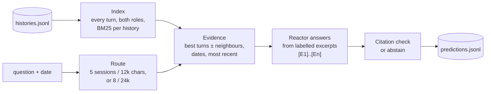

# Recall: a memory layer on Reactor

Our submission to the RxAI Memory Retrieval Challenge ([CHALLENGE.md](CHALLENGE.md) is the organisers' brief;
[format.md](format.md) the data format).

Recall gives an assistant a reliable memory of months of past conversations. For each question, our own retrieval
(turn-level BM25, standard library only) finds the few passages that matter in a history of hundreds of sessions and
sends them to Reactor as dated, labelled excerpts. **Reactor writes every final answer.** We then check its
citations: we keep Reactor's own `[E#]` labels, or, when it gives none, cite only excerpts that contain its answer.
When the history doesn't answer the question, Recall abstains, with no citations.

## Results

**Test run (the submission, `predictions.jsonl`).** All 146 test questions were answered by Reactor
(`results-test-v3.jsonl`):

| | first run (v1, `predictions-v1.jsonl`) | submission (v3, `predictions.jsonl`) |
|---|---|---|
| answers, each citing its sources | 115 | **123** |
| abstained | 31 of 146 (21%) | **23 of 146 (16%)** |

All 123 v3 answers cite with Reactor's own labels on the answer line. The test split also has unanswerable
questions, so some of the 23 abstentions are correct; the official scores will tell how many.

**Retrieval on dev** (offline, `eval_retrieval.py`; `metrics/retrieval-*-v3.json`). *hit@5*: a gold session is in
the top 5; *sent*: share of gold sessions in the evidence sent; *ans∈ev*: the gold answer appears in the evidence
sent.

| split | answerable questions | hit@5 | sent | ans∈ev |
|---|---|---|---|---|
| dev (~50 sessions per history) | 496 | 0.982 | 0.954 | 0.556 |
| dev-large, first 130 questions (~500 sessions per history) | 124 | 0.935 | 0.878 | 0.492 |

v1 has the same hit@5 and sent, and an ans∈ev of 0.542 on dev and 0.484 on dev-large (`metrics/retrieval-*-v1.json`).

**v1 vs v3 with Reactor, on 24 hard dev-large questions** (`sample_hard.jsonl`: 10 name questions, 8 temporal,
counting or update questions, 6 unanswerable; `results-hard-v1.jsonl` vs `results-hard-v3.jsonl`, scored by
`compare.py` with `score.py`'s matcher):

| | v1 | v3 |
|---|---|---|
| correct | 15 of 24 | **16 of 24** |
| unjudged (left to the official LLM judge) | 4 | 4 |
| false abstentions (of 18 answerable) | 5 | **4** |
| unanswerable questions abstained on | 6 of 6 | 6 of 6 |
| evidence F1 | 0.67 | **0.75** |

The gains are on name questions (correct 6 → 7 of 10, false abstentions 2 → 1), and v3 still abstains on every
unanswerable question.

**Efficiency** (`efficiency.py` on the final run's evidence log, `results-test-v3.evidence.jsonl`). It counts the
whole message per question (question, instructions, excerpts and the client's template, built with
`reactor/client.py`'s `build_message`), against a full test history of 1.66M characters (median):

| | |
|---|---|
| message per question | median **11.3k** characters (max 21.0k): **147× less** than the full history |
| all questions of a dataset history together | median **114k** characters: **15× less** than loading the history once (11–25×) |

## How it works



- **Index.** Every turn of both roles is a chunk (long turns split into ~1,500-character windows), scored with
  BM25; a session scores its best chunk plus a share of its next two. Assistant turns are indexed because "what
  did you recommend…" questions are answered only there.
- **Route.** Counting, ordering and time questions ("how many", "which first", "how long ago") and name questions
  get 8 sessions in 24,000 characters; the rest 5 sessions in 12,000.
- **Evidence.** The best turns with their neighbours, each trimmed to the stretch with the most question words.
  Each excerpt carries its session date and "(N days before the question date)", and the latest is marked
  `[most recent]`; for counting and time questions, the user's sentences that say when something happened are
  added.
- **Reactor answers.** One message per question through the organisers' `reactor/client.py`, asking for the
  `[E#]` labels on the FINAL ANSWER line and to answer INSUFFICIENT_EVIDENCE only if nothing in the evidence
  addresses the question.
- **Citation check / abstain.** `make_predictions.py` maps Reactor's labels to session ids; INSUFFICIENT_EVIDENCE,
  or no answer at all, becomes an abstention with no citations.

Hard cases handled:

- **Knowledge updates**: the most recent value wins, unless the question asks for the previous or original one.
- **Temporal questions**: dates and day counts are computed in code, not left to the model; counting and ordering
  questions are asked to work out the difference, total, count or order before the answer line.
- **Name questions** ("what's my dog's name?"): synonyms for the entity word (dog → puppy, pet; partner → husband,
  wife) and a boost for passages with a name near it, because names are often said in passing.
- **Near-miss traps**: Reactor answers only from the excerpts and says INSUFFICIENT_EVIDENCE when nothing in them
  addresses the question; v3 abstained on all 6 unanswerable hard questions. An optional missing-words hint
  (`--hint`) names question words absent from the evidence; the submission runs without it, to favour answering.
- **Reactor latency and restarts**: a timed-out question is listened for (`listen.py`) before it is asked again in
  the same history, and late answers are recovered. After a new history, the driver waits for the agent to come
  back up and retries a question it dropped.

## Setup

```sh
python3 --version                          # 3.11 or newer
python3 -m venv .venv && . .venv/bin/activate
pip install websockets streamlit           # websockets for the Reactor client; streamlit for the demo only
```

Data: download `dev.tar.gz`, `test.tar.gz` (and optionally the dev-large archive) from the challenge's
[Releases](https://github.com/RxAI-dev/memory-challenge/releases) and extract them in the repository root, giving
`dev/`, `test/` and `dev-large/`. `convert_longmemeval.py` rebuilds the dev splits from LongMemEval.

Access key: type it at a hidden prompt in the terminal you run from. Never put it in a file or on a command line.

```sh
printf 'Access key: '; read -rs REACTOR_ACCESS_KEY; echo; export REACTOR_ACCESS_KEY
```

## Reproduce the submission

The submission is tagged `final-submission`. `predictions.jsonl` came from these two commands:

```sh
python run_v3_test.py --questions test/questions.jsonl --histories test/histories.jsonl \
    --base-url <your base URL> --agent-id <your agent id> --out results-test-v3.jsonl
python make_predictions.py results-test-v3.jsonl --questions test/questions.jsonl --out predictions.jsonl
```

- **Runtime:** about 3 hours on one agent. In our run, Reactor's answers took 2.7 h in total (median 63 s per
  question); with one 600 s timeout and the waits after each new history, the run took about 4 h end to end.
- **Resume:** each answer is appended to `results-test-v3.jsonl` as it arrives. Rerunning the same command asks
  only the questions not yet answered, carrying on in the agent's current Reactor history without a reset.
- `make_predictions.py` checks its output with `score.py`'s format validator. From the committed
  `results-test-v3.jsonl` it rebuilds `predictions.jsonl` byte for byte, without calling Reactor.
- `tests/test_run_v3_test.py` proves, with a fake client, that `run_v3_test.py` sends exactly what
  `run_v3.py --no-hint --lenient` sends.

## Evaluate offline

No Reactor calls:

```sh
python eval_retrieval.py dev --version 3                      # retrieval metrics
python eval_retrieval.py dev-large --limit 130 --version 3
python compare.py results-hard-v1.jsonl results-hard-v3.jsonl --questions sample_hard.jsonl --gold dev-large/gold.jsonl
python efficiency.py results-test-v3.evidence.jsonl --questions test/questions.jsonl --histories test/histories.jsonl
python -m unittest discover tests
```

`score.py dev/gold.jsonl predictions.jsonl` scores a full dev run (the two commands above with `dev/` in place of
`test/`; that one calls Reactor). `compare.py` scores a subset, such as `sample_hard.jsonl`.

## Demo app

```sh
streamlit run app.py --server.address localhost
```

Recall's chat interface: ask about a user's history and see the answer, the conversations it came from (cited
passages highlighted) and how it was answered (what was sent, and how many characters against the whole history).
Saved answers come from the `results-*.jsonl` files and retrieval runs live; by default the app never calls
Reactor.

Live mode (`REACTOR_LIVE=1`, with `REACTOR_BASE_URL`, `REACTOR_AGENT_ID` and `REACTOR_ACCESS_KEY` in the
environment) asks Reactor directly. **Don't use it while a benchmark runs on the same agent**: asking starts a new
Reactor history, which ends the benchmark's.

## Repository layout

| File | Role |
|---|---|
| `retrieval.py` | the index, routing and evidence (`HistoryIndex`; versions 1–3) |
| `run_v3_test.py` | **the driver for the submission**: `run.py`'s driver with v3 evidence and question text |
| `run.py` | the base driver (v1): one Reactor history per dataset history, timeouts, resume, restarts |
| `run_v2.py`, `run_v3.py` | the v2/v3 question text (`prompt_v2`) and drivers, used by `run_v3_test.py` and its test |
| `listen.py` | listens for a timed-out question's late answer, sending nothing |
| `make_predictions.py` | results → `predictions.jsonl`: citations, abstention, late answers |
| `eval_retrieval.py`, `score.py` | offline retrieval metrics; scoring against dev gold |
| `compare.py`, `efficiency.py` | two runs side by side against gold; characters sent vs the full history |
| `app.py`, `.streamlit/` | the demo app (its saved answers: `results-sample10.jsonl`, `results-demo4-v3.jsonl`) |
| `predictions.jsonl`, `results-test-v3.jsonl` | the submission, the Reactor results it is built from, and their evidence log |
| `predictions-v1.jsonl`, `results-test.jsonl` | our first test run (v1) |
| `sample_hard.jsonl`, `results-hard-*.jsonl` | the 24-question v1 vs v3 comparison |
| `metrics/` | saved `eval_retrieval.py` output |
| `tests/` | unit tests, with a fake client that never calls Reactor |
| `reactor/` | the organisers' kit, unchanged |
| `convert_longmemeval.py`, `uncued_assistant.jsonl` | rebuilds the dev splits from LongMemEval |
| `presentation/` | our presentation |

## Compliance

- **Every final answer comes from Reactor**, through the organisers' unmodified `reactor/client.py`. We don't edit
  answers; we only choose the citations and turn INSUFFICIENT_EVIDENCE into an abstention.
- **No external LLM or embedding API** anywhere in the pipeline; standard library only, apart from `websockets`
  (the client) and `streamlit` (the demo).
- **One Reactor history per dataset history**, started with `--new-history` and never reset mid-history, with one
  exception in the submission run: dataset history `h_8224cd1fdcd0`'s fifth question timed out after 600 s, and
  when it was asked again the server reported `history_changed`, so it and the last five questions of that
  dataset history ran in a new Reactor history. All 10 were answered (16 Reactor histories for 15 dataset
  histories).
- **Citations follow the organisers' ruling** that fallback citations must support Reactor's answer:
  1. Reactor's `[E#]` labels on the answer line;
  2. else the labels in the last paragraph of its reasoning;
  3. else the excerpts that contain its answer (or most of its content words), only if that singles out at most
     half of them;
  4. never the top-ranked session by default; abstentions cite nothing.
- Built with Claude Code as a coding assistant.

## Limitations and next steps

- **Latency**: about a minute per question, so a test run takes hours on one agent.
- **Abstention vs. traps**: the lenient prompt lowered abstentions from 21% to 16%; without test gold we can't yet
  say whether it lets near-miss traps through. The missing-words hint is the guard to bring back if it does.
- **Wording gaps**: questions worded differently from the conversation (siblings vs. brother) are where dev-large
  retrieval drops most; a local reranker on the BM25 candidates would help.
- **Relative dates** ("three weeks ago") are passed through, not converted to dates in code.

## Team

Amaan Rais Shah, Dedar Alam, Frensi.
