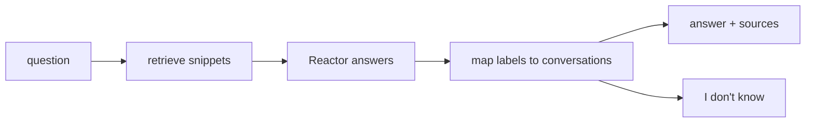

# Recall

Long-term memory for AI assistants: every answer shows where it came from, or says "I don't know".

Our retrieval finds the few relevant snippets in months of chat history. Reactor writes every final answer from
them and names the snippets it used; we map those labels to the conversations they came from. When the history
doesn't contain the answer, Recall says "I don't know".

Our submission to the RxAI Memory Retrieval Challenge ([brief](CHALLENGE.md), [data format](format.md)).

## Results

| | Value |
|---|---|
| Test questions handled by Reactor | 146 / 146 |
| Answers with a cited source | 123 |
| "I don't know" | 23 (16%, down from 21% in our first run) |
| Text sent to Reactor per question vs the full history | ~147× less |
| vs loading a user's history once | ~15× less |
| Trick questions answered "I don't know" (hard dev-large sample) | 6 / 6 |

No test accuracy is available. On 24 hard practice questions: 16 correct, 4 unjudged.

Details and dev metrics: [docs/DETAILS.md](docs/DETAILS.md).

## How it works



- **Index:** every turn of the history, both user and assistant, is searchable (BM25). The pipeline uses only the
  standard library, plus websockets in the organisers' client.
- **Retrieve:** the best 5 sessions (8 for counting, time and name questions), trimmed to the relevant turns.
- **Dates:** each snippet carries its date and "N days before the question"; the latest is marked most recent.
- **Answer:** Reactor answers from the labelled snippets `[E1]..[En]` through the organisers' client.
- **Sources:** the labels Reactor names become session citations (all 123 submitted answers had them);
  "insufficient evidence" becomes "I don't know".

## Quickstart

Steps 3-4 need a team Reactor agent (base URL, agent ID and access key from the organisers). The demo app needs the
data downloaded in step 2.

1. Create a virtual environment (Python 3.11+) and install the two dependencies:

   ```sh
   python3 -m venv .venv && . .venv/bin/activate && pip install -r requirements.txt
   ```

2. Download `dev.tar.gz` and `test.tar.gz` from the challenge's
   [Releases](https://github.com/RxAI-dev/memory-challenge/releases) into the repository root and extract them:

   ```sh
   tar -xzf dev.tar.gz && tar -xzf test.tar.gz
   ```

3. Set the access key at a hidden prompt. Never put it in a file or on a command line.

   ```sh
   printf 'Access key: '; read -rs REACTOR_ACCESS_KEY; echo; export REACTOR_ACCESS_KEY
   ```

4. Run the test set (about 4 hours on one agent; rerun the same command to resume):

   ```sh
   python run_v3_test.py --questions test/questions.jsonl --histories test/histories.jsonl \
       --base-url <your base URL> --agent-id <your agent id> --out results-test-v3.jsonl
   ```

5. Build the predictions:

   ```sh
   python make_predictions.py results-test-v3.jsonl --questions test/questions.jsonl --out predictions.jsonl
   ```

The submission is tagged `final-submission`.

## Other commands

```sh
python eval_retrieval.py dev --version 3                 # evaluate retrieval offline
python score.py dev/gold.jsonl predictions.jsonl          # score a dev run (steps 4-5 with dev/)
streamlit run app.py --server.address localhost           # the demo app (never calls Reactor by default)
```

## Files

| File | Role |
|---|---|
| `retrieval.py` | search index, routing and snippets |
| `run_v3_test.py` | the driver that produced the submission (built on `run.py`) |
| `make_predictions.py` | results → `predictions.jsonl`: citations and "I don't know" |
| `predictions.jsonl`, `results-test-v3.jsonl` | the submission and Reactor's raw results |
| `eval_retrieval.py`, `score.py` | offline retrieval metrics; scoring against dev gold |
| `app.py` | the demo app |
| `tests/` | unit tests, with a fake client that never calls Reactor |
| `reactor/` | the organisers' kit, unchanged |

## Business case

- **Who it's for:** support teams and AI assistants that must remember what was said in earlier chats.
- **The problem:** a confident wrong answer costs trust, and re-reading a whole history sends far more text to the
  model. On the test set, Recall sent ~147× less text per question than the full history.
- **How it would be offered:** a retrieval layer in front of an existing assistant. Search runs on the customer's
  own systems, and each answer shows its sources.
- **Before production:** Reactor takes about a minute per answer, and trap questions aren't solved: we can't yet say
  whether the lenient prompt lets near-miss traps through.

## What I'd do next

- A local reranker on the BM25 candidates, for questions worded differently from the chat.
- Relative dates ("last month", "three weeks ago") converted to dates in code.
- An abstention check that doesn't rely only on Reactor.

## Rules we followed

- Every final answer comes from Reactor, through the organisers' unmodified client.
- No external LLM or embedding API anywhere in the pipeline.
- One Reactor history per dataset history; one was split after a timeout (see
  [DETAILS](docs/DETAILS.md#5-the-test-runs)).
- Citations follow the organisers' ruling: Reactor's own labels, or only snippets that contain its answer.

## Team

Team Null Pointer: Amaan Rais Shah, Dedar Alam, Frensi.

## Credits

- Built by Team Null Pointer at the START Warsaw x Poland Tech Week Hackathon, 30-31 October 2026.
- Reactive AI, for the Memory Retrieval Challenge, Reactor and the challenge kit.
- OpenAI, tech partner of the challenge.
- [LongMemEval](https://arxiv.org/abs/2410.10813) (arXiv 2410.10813), the source of the dev data. MIT licence,
  Copyright (c) 2024 Di Wu.
